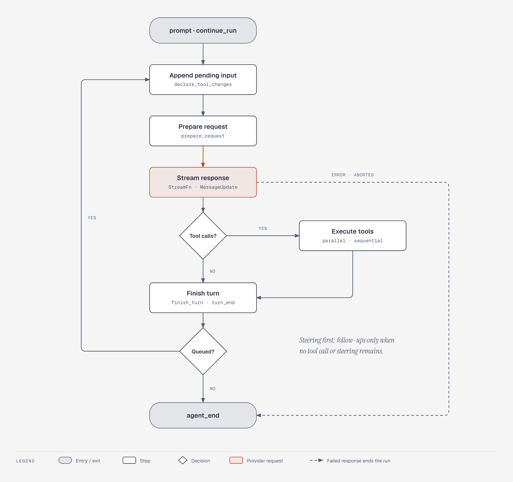

# tau-agent-runtime（`tau_agent`）设计文档

`tau-agent-runtime` 是 [`@earendil-works/pi-agent-core`](https://github.com/earendil-works/pi/tree/main/packages/agent) 的 Rust 移植，代码里 `use tau_agent::...`。它在 [`tau_ai`](../../../ai/docs/design/README.md) 之上实现有状态的 agent：维护对话记录、执行工具调用、处理 steering 与 follow-up 队列、发出生命周期事件。

设计以上游为准。Rust 语言层面必须改写的地方在各文档的“与上游的差异”里列出；属于改进或行为变化的放在“待确认”，确认前不实现。

## 文档索引

| 文档 | 模块 | 内容 |
| --- | --- | --- |
| [types.md](types.md) | `types` | `AgentMessage<C>`、自定义消息、事件、工具结果、钩子返回值 |
| [tools.md](tools.md) | `tool` | `AgentTool` trait、`FnTool`、`typed_tool`、工具执行的各个步骤 |
| [loop.md](loop.md) | `agent_loop`、`hooks` | 底层循环、`AgentHooks`、`StreamFn`、工具声明变更 |
| [agent.md](agent.md) | `agent` | `Agent` 句柄、状态归约、监听器、队列、中止与空闲 |
| [proxy.md](proxy.md) | `proxy` | 通过应用自己的服务器转发模型请求的 `stream_proxy` |

## 总体结构

两层，与上游相同：

1. **底层循环**（`run_agent_loop` / `agent_loop`）：无状态函数。输入上下文、配置、事件接收端、取消令牌和 `StreamFn`，输出本次运行新增的消息。
2. **`Agent`**：持有状态的句柄。把状态和队列转成循环的配置，把循环事件归约进状态，再按订阅顺序交给监听器。

循环在内部一直使用 `AgentMessage<C>`，只在请求 provider 前经 `transform_context` → `convert_to_llm` → `normalize_context` 转成 LLM 消息。

一次运行的流程：



（可交互版本：[diagrams/agent-loop.html](diagrams/agent-loop.html)）

- 每一轮（turn）是一次助手回复加上它的工具调用。
- 回复以 `error` 或 `aborted` 结束时，发出 `TurnEnd` 和 `AgentEnd` 后结束运行，不执行工具、不读队列。
- 一轮结束后先读 steering 队列；只有在没有工具调用要继续、也没有 steering 消息时才读 follow-up 队列。

## crate 组织

```
crates/agent/
  docs/design/     # 本目录
  src/
    types.rs       # 消息、事件、工具结果
    tool.rs        # AgentTool trait 与便捷实现
    hooks.rs       # StreamFn、AgentHooks、AgentLoopConfig
    agent_loop.rs  # 底层循环与工具执行
    agent.rs       # Agent 句柄
    proxy.rs       # stream_proxy
  tests/           # 移植自上游 test/
```

| feature | 默认 | 内容 |
| --- | --- | --- |
| `schemars` | 开 | `typed_tool` 与 `schema_for`：从 Rust 类型生成工具参数的 JSON Schema |

## 已确认的设计决定

| 问题 | 决定 |
| --- | --- |
| 自定义消息 | 泛型参数：`AgentMessage<C = NoCustom>`，`C: CustomMessage`。上游用 TypeScript 声明合并扩展 `AgentMessage`。见 [types.md](types.md) |
| 工具定义 | `AgentTool` trait；另有 `FnTool`（声明 + 闭包）和 `typed_tool`（参数类型由 schemars 生成 schema，feature 可关）。见 [tools.md](tools.md) |
| 丢弃事件流 | 与 `tau_ai` 一致：drop 即取消。`agent_loop` 返回的 `AgentEventStream` 在运行结束前被 drop 时取消本次运行（取消的是调用方令牌的子令牌）；需要跑完时调用 `result()` |
| `MessageUpdate` 里的消息 | `Arc<AssistantMessage>` 快照，每个更新事件克隆一次当前消息。上游直接传可变的 partial 引用 |
| 包名 | 暂定 `tau-agent-runtime`（`tau-agent`、`tau-agent-core` 在 crates.io 已被占用），库名 `tau_agent` |

## 与上游的差异（Rust 语言层面）

- 上游的各个回调（`convertToLlm`、`transformContext`、`getApiKey`、`beforeToolCall`、`afterToolCall`、`finishTurn`、`prepareRequest`、`prepareNextTurn`）合并成一个 `AgentHooks<C>` trait，每个方法都有默认实现。钩子的输入是借用的上下文结构体，放在一个 trait 对象里比八个独立的 `Arc<dyn Fn>` 更容易表达生命周期。
- `AbortSignal` → `CancellationToken`。监听器收到 `(Arc<AgentEvent<C>>, CancellationToken)`。
- 没有全局默认 `StreamFn`（上游的 `setDefaultStreamFn`）。`AgentOptions::new(stream_fn)` 和 `run_agent_loop` 都要求显式传入；`models_stream_fn(models)` 把 `Models` 适配成 `StreamFn`。
- 循环把最终的助手消息（`Done`/`Error` 事件里的消息）写入上下文。上游写入的是流式过程中原地修改的 partial 对象，两者内容相同。
- 钩子不返回 `Result`，没有“钩子抛异常”这条路径。上游 `Agent` 捕获循环抛出的异常并合成一条失败的助手消息；Rust 里流的失败已经编码在流里，钩子和监听器的 panic 照常传播。
- `Agent` 的 `prompt`/`continue_run` 在已有运行时返回 `AgentError::AlreadyRunning`，不是抛异常。`prompt` 接收 `Vec<AgentMessage<C>>`，文本加图片用 `prompt_text`（上游 `prompt` 重载了字符串、单条消息、消息数组）。
- 状态读写用 `with_state` / `with_state_mut` 闭包，避免把锁守卫交给调用方；常用字段另有 getter/setter。

## 待确认

- 包名 `tau-agent-runtime` 是暂定的。
- 上游 `examples/mcp-codemode` 和 `test/e2e.test.ts`（需要真实 API key）不移植。
