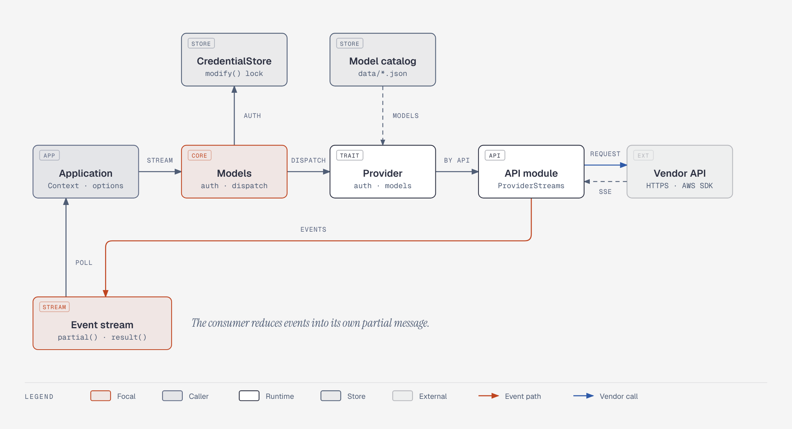
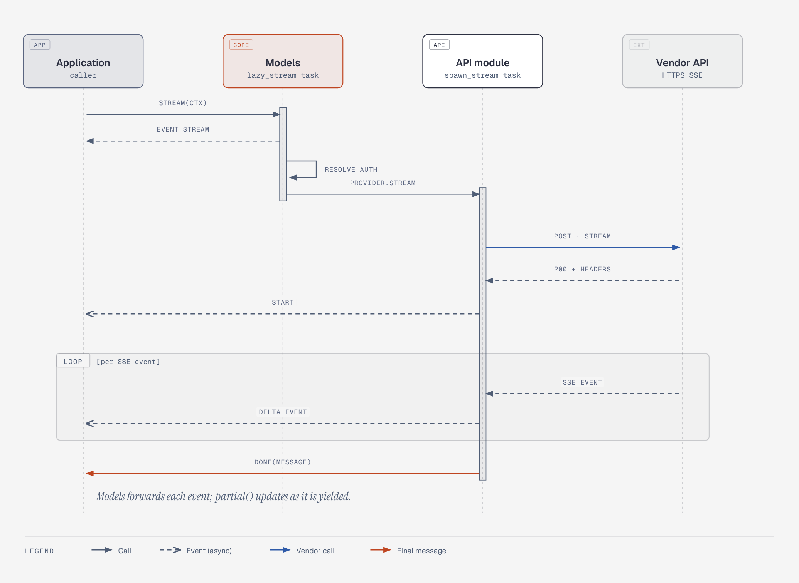

# delta-ai (`delta_ai`) design notes

`delta-ai` is the Rust port of [`@earendil-works/pi-ai`](https://github.com/earendil-works/pi/tree/main/packages/ai). The crates.io package is `delta-ai`; code imports it with `use delta_ai::...`. Upstream design wins. Changes that Rust as a language forces are listed under "Differences from upstream" in each document. Improvements and behavior changes go under "Pending confirmation" and are not implemented until confirmed.

## Document index

| Document | Modules | Contents |
| --- | --- | --- |
| [types.md](types.md) | `types`, `model`, `compat` | Messages, content blocks, models, compat configuration; JSON shape matches upstream |
| [events.md](events.md) | `events` | Event protocol, `AssistantMessageEventStream`, `MessageBuilder` |
| [models-and-providers.md](models-and-providers.md) | `models`, `provider` | The `Models` collection, the `Provider` trait, `create_provider`, dynamic model refresh |
| [auth.md](auth.md) | `auth` | Credentials, credential store, API key and OAuth, resolution order and locked refresh |
| [transcript.md](transcript.md) | `transcript`, `transform`, `estimate`, `simple_options` | System message replay, cross-provider switching, token estimation, thinking budgets |
| [http.md](http.md) | `http`, `json`, `api::common`, `api::constrained_sampling` | SSE decoding, retries, error bodies, streaming JSON parsing, API task framework, shared constrained sampling |
| [catalog-and-faux.md](catalog-and-faux.md) | `providers::catalog`, `providers::faux` | Built-in model catalog, faux provider for tests |
| [cloudflare.md](cloudflare.md) | `api::cloudflare`, `providers::cloudflare` | Cloudflare AI Gateway and Workers AI: auth, endpoint placeholders |
| `api-*.md` | `api::*` | Implementation of each wire protocol, one document per API |

## Overall structure



(Interactive version: [diagrams/architecture.html](diagrams/architecture.html))

Three layers, as in upstream:

1. **`Models`**: the collection the application holds. It resolves auth per provider, merges request headers, normalizes the context, and then hands the request to the provider that owns the model.
2. **`Provider`**: the runtime unit. It owns the model catalog, the auth method (API key / OAuth) and the request behavior. Built-in providers are assembled with `create_provider`.
3. **API implementation** (`ProviderStreams`): the wire protocol, for example `anthropic-messages` or `openai-completions`. Several providers share one API implementation (xAI, Groq, OpenRouter and others all use `openai-completions`).

Sequence of one `Models::stream` request:



(Interactive version: [diagrams/stream-sequence.html](diagrams/stream-sequence.html))

`Models::stream` returns the event stream synchronously. Auth resolution and provider dispatch run in a background task (upstream's `lazyStream`). The API implementation sends the request, parses SSE and emits events through `MessageBuilder`, all in its own Tokio task. Each time the consumer takes an event, it reduces the event into its own `partial()`.

## Crate layout

```
crates/ai/
  data/providers/*.json   # model catalog generated by upstream (synced by scripts/sync-models.sh)
  docs/design/            # this directory
  src/
    types.rs model.rs compat.rs options.rs error.rs
    events.rs             # event protocol and event stream
    auth.rs               # credentials and auth
    provider.rs models.rs # Provider trait and Models collection
    transcript.rs transform.rs estimate.rs simple_options.rs json.rs
    http.rs               # HTTP/SSE helpers shared by hand-written clients
    api/                  # one module per wire protocol
    providers/            # model catalog, faux, provider factories
```

Upstream controls bundle size with subpath imports and lazy loading. Rust controls build size with cargo features. The hand-written APIs (Anthropic, OpenAI, Gemini, Mistral) have no extra dependencies and are always compiled. The two APIs that depend on official SDKs sit behind features:

| feature | API | Dependencies |
| --- | --- | --- |
| `bedrock` | `bedrock-converse-stream` | `aws-sdk-bedrockruntime`, `aws-config` (official AWS) |
| `vertex` | `google-vertex` | `google-cloud-aiplatform-v1`, `google-cloud-auth` (official Google) |
| `full` | All of the above | |

## Provider implementation strategy

Use the official Rust SDK when one exists; otherwise hand-write the client (`reqwest` + `delta_ai::http`). No third-party SDK crates. Survey results as of 2026-10:

| Vendor | Official Rust SDK | Approach |
| --- | --- | --- |
| Anthropic | None (official SDKs: Python, TS, C#, Go, Java, PHP, Ruby) | Hand-written |
| OpenAI | None (official SDKs: TS, Python, .NET, Java, Go, Ruby) | Hand-written |
| Google Gemini API | None (official SDKs: Python, JS, Go, Java, C#) | Hand-written |
| Google Vertex AI | Yes: `google-cloud-aiplatform-v1` | Official crate |
| AWS Bedrock | Yes: `aws-sdk-bedrockruntime` | Official crate |
| Mistral | None | Hand-written |

The hand-written clients consulted the Zed and litellm-rs implementations to avoid known pitfalls. Findings are in [`docs/research/provider-references.md`](../../../../docs/research/provider-references.md). Zed's provider crates are GPL-3.0: we read them for behavior only and do not copy code.

## Confirmed design decisions

| Question | Decision |
| --- | --- |
| `partial` in events | Consumer-side reduction: events carry no `partial`; `AssistantMessageEventStream::partial()` returns the message as of the event just taken. See [events.md](events.md) |
| Vertex AI | Use the official `google-cloud-aiplatform-v1` + `google-cloud-auth` |
| API-specific options | `StreamOptions` holds the common fields; `api: Option<ApiOptions>` is a typed enum with one variant per built-in API, plus `Custom(JsonObject)` |
| Package name | crates.io uses `delta-*` (`pi-*` belongs to upstream); this package is `delta-ai`, library name `delta_ai` |
| Dropping the event stream | Cancels the request: after `AssistantMessageEventStream` is dropped, the producer detects the closed channel (`MessageBuilder::is_closed`), stops reading and closes the HTTP connection. In upstream JS the request keeps running to completion. If the request must run to completion, call `result()` first |

## Differences from upstream (Rust language)

These are language-level rewrites. They do not change observable behavior (except where noted):

- `AbortSignal` → `tokio_util::sync::CancellationToken` (`StreamOptions::cancel`). Public async operations are cancelled in Rust by dropping the future, so credential store and model store methods take no signal parameter.
- The `fetch` option → `http_client: Option<reqwest::Client>`; millisecond values such as `timeoutMs` → `Duration`.
- Callbacks (`on_payload`, `on_response`, `on_provider_stream_event`) are `Arc<dyn Fn(..) -> BoxFuture<Result<..>>>`. Returning an error fails the request, matching upstream's throw semantics.
- `transformHeaders` lives in `StreamOptions::transform_headers`. `Models` consumes it and clears it, so the provider never sees it (upstream uses an option type specific to `Models`).
- `AuthContext`'s `env`/`file_exists` are synchronous methods (upstream returns a Promise, but every implementation reads synchronously).
- OAuth refresh runs in a separate Tokio task. If the caller's future is dropped, the refresh still completes and writes back. This replaces upstream's approach of "ignore the signal once refresh starts; only the timeout applies".
- In the persisted model catalog, models of unknown type are dropped when `ModelsStoreEntry` is deserialized (upstream filters them after reading).
- Estimates based on string length (token estimation, faux cache simulation) count UTF-16 code units, matching upstream JS `length`.

## Pending confirmation

Not ported in the first phase: telemetry (to be wired in once `delta-telemetry` is ported), image generation, classifiers, deferred responses, OAuth login flows (the `Models::login` framework exists; the per-provider flows are not written), OpenAI Codex and WebSocket transport, GitHub Copilot, Cloudflare, Radius (`pi-messages`). The model catalog already contains data for these models.

Pending confirmation items for each API are in the matching `api-*.md`.
