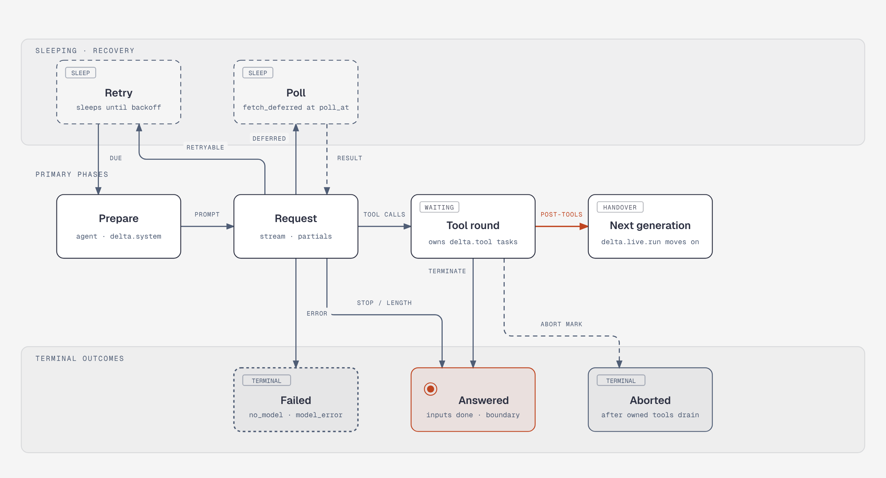

# Generation (`generation`)

Corresponds to upstream `src/harness/generation.ts`, `live.ts` (the generation and tool
slots) and `usage.ts`. Follows spec §8.3 (generation), §8.5 (tool rounds), §8.6 (usage),
§8.2 (live document), the generation rows of §8.1, the generation hooks of §7.2 and the
effect sandwich of §5.2. The task machinery is in [scheduler.md](scheduler.md), prompt
preparation in [context.md](context.md), boundaries in [inbox.md](inbox.md), the tool task
in [tool.md](tool.md), compaction in [compaction.md](compaction.md).

## Problem

One model request is an external effect that may take minutes, stream partial output the
UI wants to see, fail in retryable and non-retryable ways, overflow the context window,
return a deferred handle to poll, or call tools whose results start the next request. The
`delta.generation` task makes each of those a durable phase: every observable step is a
committed revision of `delta.live` or a transcript entry, a crash loses at most one throttle
window of partial output, and a reopened storage resumes from the phase checkpoint.

## Checkpoint and task

```rust
#[derive(Serialize, Deserialize, Clone, PartialEq)]
#[serde(tag = "phase", rename_all = "snake_case")]
pub enum GenerationCheckpoint {
    Prepare { attempt: u32, compacted: Option<TaskId>, overflow: Option<String>, threshold: Option<bool> },
    Request { attempt: u32, compacted: Option<TaskId>, model: ModelRef, thinking_level: ModelThinkingLevel,
              stream_options: ConversationStreamOptions, cutoff: EntryId },
    Retry   { attempt: u32, compacted: Option<TaskId>, until: i64 },
    Poll    { attempt: u32, compacted: Option<TaskId>, model: ModelRef, cutoff: EntryId, handle: DeferredHandle, poll_at: i64 },
    Tools   { assistant: EntryId, tools: Vec<TaskId>, pending: Vec<String> },   // held by `waiting`
}
pub struct GenerationInput;                      // `{}`
pub struct GenerationResult { pub entry_id: EntryId }

pub struct GenerationTask;                       // name "delta.generation", version 1
impl TaskDefinition for GenerationTask { /* initial: Prepare { attempt: 1, .. } */ }
impl TaskHooks for GenerationTask { type Hooks = dyn GenerationHooks; }   // harness.md
```

`Option` fields serialize with `skip_serializing_if`, so an absent field is absent in the
stored JSON. The run's inputs live in `delta.live.run`, not in the task input.

## Live document (§8.2)

```rust
pub struct LiveState {
    pub run: Option<RunControl>,                 // { task_id, inputs }: present exactly while busy
    pub generation: Option<LiveGeneration>,      // { attempt, message?: Json, retry?: { at, error }, deferred?: { poll_at } }
    pub nested_tools: Option<Vec<NestedToolSlot>>, // tool.md
    pub tools: Option<Vec<ToolSlot>>,            // the current round in call order
    pub compactions: Option<Vec<CompactionStatus>>,
    pub compaction_failure: Option<CompactionFailure>,
}
pub struct ToolSlot { pub call_id: String, pub name: String, pub task_id: Option<TaskId>, pub status: SlotStatus /* Pending | Running | Done */,
                      #[serde(flatten)] pub progress: SlotProgress, pub entry: Option<EntryId> }
pub struct SlotProgress { pub output: Option<String>, pub dropped_bytes: Option<u64>, pub dropped_lines: Option<u64>,
                          pub details: Option<Json>, pub diagnostics: Option<Vec<ToolDiagnostic>> }
```

| field | value |
| --- | --- |
| kind / version | `delta.live` / 1 |
| scope / history / fork | conversation, `latest`, `initial` |
| `initial()` | `{}` |
| checkpoint | complete base whenever nothing runs: `generation` absent and no `Running` tool or nested slot |
| created | with every Harness conversation |

The definition types `LiveDoc` and `UsageDoc` are in [documents.md](documents.md); `LiveState` and
`UsageState` are the typed views this module reads and writes through `Doc::update_as`
and the draft handle.

Nothing runs while idle, at a final boundary, in the commit that hands over to a tool round
(every slot `Pending` or `Done`), between the tools of a sequential round, and whenever no
tool of a parallel round is running; so every base is small and a delta chain spans at most
one generation with its retries and polls, or one round's overlapping executions. A slot
holds output only while `Running`; retained output grows by string appends (`a` ops) and a
sliding tail is a trim plus an append when chord's overlap search finds the shared part
([chord delta.md](../../../chord/docs/design/delta.md)). Partials are strict JSON before
assignment. Every terminal path of a run task removes `run`, `generation` and `tools` in the
commit that settles the run's inputs.

## The phases



The diagram ([html](diagrams/generation-lifecycle.html)) shows the primary rail, the two
sleeping states and the terminal outcomes; the overflow path (request → compaction →
prepare) is described below and left out of the picture.

| Phase | Does | Closing commit writes |
| --- | --- | --- |
| `Prepare` | Resolves the agent and settings once; `no_model` when the agent has no model or `models.get_model` does not know it. Resumed with `overflow` and a compaction that did not complete with an `entry_id`: fails `model_error` with the overflow text. Resumed with `threshold` and a non-completed compaction: fails `model_error` with `Compaction failed: <error>` / `Compaction was aborted`. Otherwise reads the context view, replays, renders and plans ([context.md](context.md)) and checks the compaction thresholds | Planned `delta.system` entries; `Running(Request { cutoff: new tail, model, thinking_level, stream_options })`; or a background compaction task and status in the same commit; or a blocking compaction task owned by the generation, its status, and `Waiting { on: [it], AllSettled, Prepare { attempt, compacted, threshold: true } }` |
| `Request` | Converts a leftover committed partial into an aborted `delta.assistant` entry (first commit), resolves the pinned model, runs the `before_request` chain, streams through `cutoff` with the invocation context, `reasoning` = thinking level (omitted for `Off`), the conversation's provider `session_id`, the pinned options; commits throttled partials; stops the throttle; `after_response`; classifies | See classification |
| `Retry` | Due: back to `Prepare { attempt + 1 }`, so agent and settings changes during the backoff apply. Early: sleeps again with the same checkpoint | `Running(Prepare)` or `Sleeping` |
| `Poll` | Due: `models.fetch_deferred(handle)`; a still-deferred result sleeps until a strictly later `poll_at`; another result is classified. Early: sleeps again. Model gone after reopen: `no_model` once due | See classification |
| `Tools` | Resumed by the scheduler once every task in `on` is terminal (§8.5, below) | Next sequential task, or the round's end |

Thresholds (checked in `Prepare` before its commit, when the policy is enabled, the model's
`context_window > 0` and `compacted` is absent): the estimate starts at the newest assistant
message in the committed context whose entry was appended after the head marker and whose
usage is nonzero, `delta_ai::calculate_context_tokens(usage)` plus
`estimate_message_tokens` of every later context message and of the planned system
messages; without one, every message is estimated. Both thresholds apply only when range
selection finds a cut ([compaction.md](compaction.md)). Above `context_window −
reserve_tokens`: blocking compaction, as in the table. Above `context_window −
reserve_tokens − background_tokens` with `background_tokens > 0` and no compaction status in
`delta.live`: a background, conversation-owned compaction in the commit that moves to
`Request`; the generation does not wait for it.

### Streaming partials

```rust
struct PartialThrottle { interval: Duration /* settings.progress.partial_interval, default 100 ms */, pending: Option<AssistantMessage>,
                         timer: Option<Timer>, in_flight: Option<JoinHandle<()>>, stopped: bool }
```

- Every stream event with content replaces `pending`; an empty partial (the opening event)
  is skipped, so a deferred response leaves no partial. The first pending partial arms a
  timer; when it fires, one commit writes `live.generation = { attempt, message }` (an
  intermediate `rt.commit`). While that commit is in flight nothing else is armed; when it
  settles and `pending` is set, the timer is armed again (trailing edge). At most one commit
  per interval and one in flight.
- Rejections after an abort mark or close are expected and not reported; a storage error
  fails the session anyway.
- Before classification the throttle is stopped and the in-flight commit awaited, so no
  stale partial lands after the outcome. The classifying commit clears `generation.message`.
- Recovery resends the same committed messages with the same pinned model, thinking level
  and stream options and reruns `before_request`.

### Classification

One commit, after `after_response` (every terminal message; a still-deferred result is not
terminal) and with the invocation context checked (`Cancelled` → the abort invocation or
the reopened run handles the committed state):

| Stop reason | Condition | Commit |
| --- | --- | --- |
| `stop` / `length`, or `toolUse` without calls | `on_yield` chain ran before the commit; first `continue` wins | Append the answer (`delta.assistant`, usage recorded); apply the `Final` boundary. With a continuation and no selected user item or reset: append a `delta.user` with the continuation, create a successor generation and hand it `run`, inputs kept open. Otherwise settle inputs `done` (answer = the entry), remove `run` and `generation`, start a successor run for the selected user ids if any; a dropped continuation is not retried. `Terminal(Completed { entry_id })` |
| `toolUse` with calls | — | Append the answer; start the tool round; `Waiting { on: tools, AllSettled, Tools { .. } }`; `generation` removed, `tools` slots added |
| `error`, context overflow (`delta_ai::is_context_overflow`) | Policy enabled, `compacted` absent, range selection finds a cut | Append the error entry, remove `generation`, create a compaction owned by the generation (reason `overflow`), add its status, `Waiting { on: [it], AllSettled, Prepare { attempt, compacted, overflow } }`; does not count against retries. A second overflow, or one without a cut, fails as below |
| `error`, retryable (`is_retryable_assistant_error`) | `retry.enabled && attempt <= max_retries` | Append the error entry; `Sleeping { until: now + retry_delay(policy, attempt), Retry { .. } }`; `generation.retry = { at, error }` |
| other `error`, or `aborted` without an abort mark | — | Append the entry; settle inputs `unanswered` / `model_error` (detail: the error text); remove `run`, `generation`; `Terminal(Failed)`; inbox per `after_failed_run` |
| `deferred` | — | `Sleeping { until: poll_at = max(now + handle.poll_after.unwrap_or(5 s), previous poll_at + 1), Poll { .. } }`; `generation.deferred = { poll_at }` |

`retry_delay(policy, attempt) = min(base_delay × 2^(attempt − 1), max_delay)` (upstream
`retryDelayMs`); `max_retries` counts retries after the first attempt. The retry and
compaction policies are read at classification. `stop` and `length` are never classified
as overflow; the next threshold check handles a silent one.

### Abort handler

In `Poll` with a known model, `models.cancel_deferred` (a failure is reported). Then one
commit converts a committed partial into an aborted `delta.assistant` entry (usage recorded),
settles the inputs `unanswered` / `aborted`, removes `run`, `generation` and `tools`, and
ends `Terminal(Aborted)`. In the `Tools` phase it runs only after the tool tasks are
terminal: every call still in `pending` gets an `aborted` error result entry; a started
call whose task faulted or was orphaned keeps its `Done` slot without an entry. The
agent layer's scheduler cleanup hook ([scheduler.md](scheduler.md)) does the same conversion and
settlement for `faulted` and `orphaned` outcomes, with reason `faulted` (detail: the
message) or the blocked reason.

## Tool rounds (§8.5)

The round starts in the commit that appends the tool-calling answer:

1. The offered tools are replayed with `delta_ai::get_current_tools` from the committed
   context through `cutoff` (`Request` holds it; `Poll` derives it again). A call to a tool
   not offered gets its `tool_unavailable` result entry here, without a task, and a slot
   that starts `Done` with that entry.
2. Every other call gets a `delta.tool` task owned by the generation with input
   `{ kind: "model", assistant, call_id }`. The round is sequential when
   `settings.tool_execution` (read as the round starts) is `Sequential` or any called tool,
   resolved from the phase's agent as the tool task would, has `execution_mode: Sequential`:
   only the first call gets its task now and the rest wait in `pending`. Otherwise every call
   gets its task and they run in parallel.
3. `Waiting { on: tools, AllSettled, Tools { assistant, tools, pending } }`; `run` stays with
   the generation.
4. `delta.live.tools` receives one slot per call (`Pending`, or `Done` for an unoffered call);
   `generation` is removed.

`Tools` phase, resumed once every task in `on` is terminal: with calls left in `pending`,
one commit creates the next call's task and waits again with the shorter `pending`
(`tools` grows by one). Otherwise it reads the tool records with `rt.get_task`, the result
entries from the slots, runs the `after_tools` observers, and commits once:

- For every `add_tools` name in a result's `control`, edit `delta.agent`: an `Exactly` `tools`
  gets the name appended unless present, `Remove` loses it, unset stays unset; `model_tools`
  unset or `Edit` gets the name appended to `add` (loads a deferred tool). Names are written
  without consulting the registry.
- Every result requests `terminate`, or any requests `handoff`: append the handoff's
  `delta.reset` entry if any, settle the inputs `done` with the tool-calling answer, remove
  `run` and `tools`, apply the `Final` boundary.
- Otherwise remove `tools` and apply the `PostTools` boundary. A placed reset: the inputs
  settle `unanswered` / `reset` and selected user items start a successor run. Otherwise
  selected steer ids join `run.inputs`, and the commit creates the next generation, owned by
  the conversation, and hands it `run` (`run.task_id` = the successor).

It completes with `Completed { entry_id }` of the tool-calling answer. `abort_task` on the
generation therefore aborts its whole round (the cascade marks the tool tasks; they drain;
then the handler above runs).

**Handover.** The successor is created by the predecessor's closing commit with
`Prepare { attempt: 1 }`, and the predecessor's terminal state lands in the same commit; the
run never has two live generations. A fault while tools are live holds `completing` and
keeps `run` until they drained (§5.5 rule 4).

## Usage (§8.6)

```rust
pub struct UsageState { pub models: IndexMap<String, Usage>, pub tools: IndexMap<String, Usage> }   // keys: "provider/model_id", tool name
pub async fn record_usage(tx: &mut Tx, conversation: ConversationId, bucket: UsageBucket, key: &str, usage: &Usage) -> Result<(), TxError>;
pub fn add_usage(total: &mut Usage, usage: &Usage);          // every counter; optional ones once either side reports them
pub fn add_usage_state(sum: &mut UsageState, state: &UsageState);
```

| field | value |
| --- | --- |
| kind / version | `delta.usage` / 1 |
| scope / history / fork | conversation, `latest`, `initial` (a fork starts at zero) |
| `initial()` | `{ models: {}, tools: {} }` |
| checkpoint | complete base on every change |

Every writer of a `delta.assistant` entry (an answer, a failed attempt, a converted partial,
the scheduler's cleanup) adds the message's `usage` to `models` under the message's own
`provider/model` in the same commit; every writer of a `delta.tool-result` with `usage` adds it
to `tools`, as does a nested call's result commit; every compaction summarization attempt
adds its response's usage in its classifying commit. Failed and aborted attempts count.
`Harness::usage` sums every conversation's document; nothing stores a cross-conversation
total.

## Testing

Ports of `harness-generation` (every classification row, `no_model`, `on_yield`
continuation, successor runs, sequential and parallel rounds, `terminate` / `handoff`,
`add_tools`), `harness-generation-recovery` (reopen in each phase: partial conversion,
resend with pinned options, early retry and poll sleeping again, `Tools` resume),
`harness-live-deltas` (throttle timing with a paused tokio clock, one commit in flight,
base-when-idle checkpoints, slot op shapes), `spec-usage` and the generation half of
`harness-compaction` (threshold, overflow, blocked compaction outcomes). Models are
`delta_ai::Models` with fake providers replaying recorded stream events; deferred flows use
a scripted `fetch_deferred`.

## Differences from upstream

- Checkpoints are a serde-tagged enum; the phases' closing commits are `Next` values
  ([scheduler.md](scheduler.md)); intent and partial commits are intermediate `rt.commit`s.
- The throttle is a small state machine over `rt.timer` and a `JoinHandle`, with the same
  observable rule (one commit per interval, one in flight, trailing flush, stop before
  classify).
- `is_context_overflow`, `is_retryable_assistant_error` and `retry_delay` are added to
  `delta_ai`, as upstream has them in pi-ai (`utils/overflow`, `utils/retry`), and not
  reimplemented here. `fetch_deferred` / `cancel_deferred` use `delta_ai::deferred`.
- Telemetry spans and links on generation attempts are not ported.

## Decisions

- `delta.generation` is version 1; its checkpoint JSON is serde's snake_case form.
- The successor generation is created in the predecessor's closing commit (`Next`), the
  same commit as the predecessor's terminal state; upstream does the same in its runtime
  commit, so nothing observable changes.
- `is_context_overflow`, `is_retryable_assistant_error`, `retry_delay` and
  `to_tool_declaration` are added to `delta_ai`.
- Hooks are `GenerationHooks`, a per-task trait ([harness.md](harness.md)).

- Phase 4 (implementation):
  - Model access goes through the `ModelClient` seam (`model` module): `model(ref)`,
    `stream(request, ctx)` (an `AssistantMessageEventStream`), `fetch_deferred`,
    `cancel_deferred`. A stream that ends without a terminal event is an `error` attempt.
  - The throttle is a `tokio::select!` loop over the stream, an `rt.timer` and the one commit
    in flight; the in-flight commit is awaited before classification.
  - A tool round creates each call's task through `tool::create_model_call_task` (kind
    `delta.tool`, version 1, input `{ kind: "model", assistant, call_id }`, first checkpoint
    `{"phase":"call"}`), the seam the tool task of phase 5 fills; results are read back as
    `tool::ToolTaskResult`. `tool_unavailable` and `aborted` results are written with
    `tool::append_tool_result` / `harness_error`.
  - Thresholds and overflow call the `Compactor` seam (`select_cut`, `create`); the default
    `NoCompaction` finds no cut, so phase 4 never compacts and an overflow fails
    `model_error`. The estimate and thresholds themselves (`compaction::estimate_context`,
    `compaction::threshold`) are implemented.
  - `LiveState` carries `compactions` and `compaction_failure` as JSON until the compaction
    task types them; a typed edit round-trips them unchanged.

- Phase 5 (implementation): `nested_tools` is typed (`NestedToolSlot`, in
  `generation::slots` with `ToolSlot`); both slots carry the running progress as a flattened
  `SlotProgress`, so the stored JSON keeps its flat shape, and `LiveState` has the slot
  helpers the tool task and the cleanup hooks share (`tool_slot_mut`, `nested_slot_mut`,
  `slot_progress_mut`, `remove_nested_below`); `compactions` and `compaction_failure` are
  typed by the compaction module. `builtin_tasks()` returns the generation, `delta.tool`
  and `delta.compaction`. Generation requests send `ModelRequest::max_tokens: None`.
  - The scheduler cleanup hooks are `generation::AgentSchedulerHooks`: a run generation's
    partial, inputs and run marker, a tool task's slot (and nested slots); compaction status
    joins in phase 5. Its `withdraw_inputs` also removes the inputs from `delta.inbox`.

## Open (minor)

- `ConversationStreamOptions` pinned in the checkpoint is a JSON subset of
  `delta_ai::StreamOptions`; callbacks (`on_payload`, …) come from the host at request time
  and are not pinned. Position: adopt; it matches upstream's curated type.
