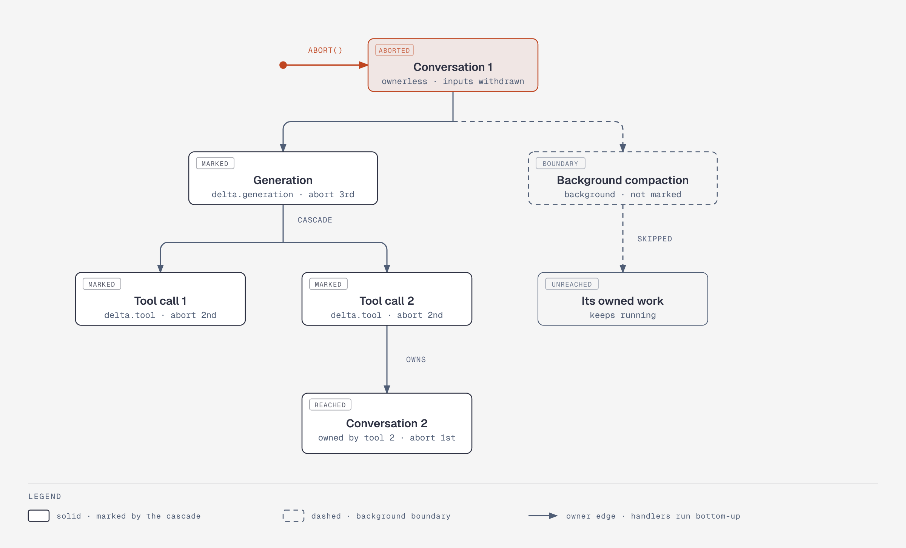

# Tasks and the scheduler (`scheduler`)

Corresponds to upstream `src/harness/scheduler.ts`, `src/tasks.ts` and the task half of
`src/harness/types.ts`. Follows spec §5 entirely (5.1 definition, 5.2 effect sandwich, 5.3
terminal tasks, 5.4 scheduler / abort / ownership, 5.5 structured concurrency, 5.6 sleeping,
timers and wakeups) and the task operations of §2.2 (`abortTask`, `retryTask`,
`waitForTask`, `waitForIdle`, `inspect`, `resume`, `wake`, `close`). Record shapes
(`TaskRecord`, `TaskState`, `TaskOutcome`, `JoinPolicy`, `TaskOwnership`) are defined in
[records.md](records.md); `Tx` and the commit line in [session.md](session.md).

## Problem

A run is a chain of external effects (a model request, a tool execution, a sleep) whose
progress must survive a crash. Upstream models each unit of work as a durable state machine:
a task record holds a phase checkpoint, a phase handler runs the effect off the commit line,
and every phase ends by committing the next state. A reopened storage reruns the current
phase from its checkpoint. On top of that sit ownership (tasks own tasks and conversations),
abort cascades, structured waits and durable sleeps.

The scheduler is the component that reserves runnable tasks, runs their handlers, applies
the precedence rules between what a handler did and what the record says, and derives the
marks that ownership implies. It knows nothing about runs, conversations' inboxes or task
kinds: every task, the agent layer's included, is a `TaskDefinition` found by name in a
catalog the layer above supplies, and that layer gives it one cleanup hook for outcomes the
scheduler writes itself (§5.4).

## Task definitions

```rust
pub trait Checkpoint: Serialize + DeserializeOwned + Clone + Send + Sync + 'static {
    fn phase(&self) -> &str;
}
impl Checkpoint for Json { /* reads the `phase` key */ }

pub trait TaskDefinition: Send + Sync + 'static {
    type Input: Serialize + DeserializeOwned + Send + Sync + 'static;
    type Checkpoint: Checkpoint;
    type Result: Serialize + DeserializeOwned + Send + Sync + 'static;

    fn name(&self) -> &'static str;
    fn version(&self) -> u32;
    fn initial(&self, input: &Self::Input) -> Self::Checkpoint;

    /// One phase: perform the effect for `phase` and return the commit that ends it.
    async fn run(&self, phase: Self::Checkpoint, rt: &TaskRuntime<Self>, ctx: &Context)
        -> Result<Next<Self>, TaskError>;
    /// Runs once after an abort mark, when the ordinary owned work drained. Must end terminal.
    async fn abort(&self, phase: Self::Checkpoint, rt: &TaskRuntime<Self>, ctx: &Context)
        -> Result<Next<Self>, TaskError>;
    /// Older stored versions; default: unsupported, the task stays blocked.
    fn migrate(&self, input: Json, checkpoint: Json, from: u32)
        -> Result<(Self::Input, Self::Checkpoint), MigrateError> { Err(MigrateError::Unsupported) }
}

/// Type-erased definition (`Arc<dyn AnyTask>`), implemented for every `T: TaskDefinition`
/// by a blanket impl that serializes at the boundary.
pub trait AnyTask: Send + Sync { fn name(&self) -> &str; fn version(&self) -> u32; fn can_migrate(&self) -> bool; /* erased run/abort/migrate */ }

/// Where the scheduler finds definitions. The agent layer's `Registry` implements it
/// (harness.md); tests use a fixed catalog.
pub trait TaskCatalog: Send + Sync {
    fn snapshot(&self) -> Arc<dyn CatalogSnapshot>;
    fn subscribe(&self) -> watch::Receiver<u64>;          // bumps on every publication
}
pub trait CatalogSnapshot: Any + Send + Sync {
    fn generation(&self) -> u64;
    fn task(&self, name: &str) -> Option<&Arc<dyn AnyTask>>;
}
```

The kernel trait has no hook type: hooks are an agent-layer concept, declared beside the
definition with the agent layer's `TaskHooks` trait ([harness.md](harness.md)).

- Typed checkpoints are serde-tagged enums, `#[serde(tag = "phase", rename_all = "snake_case")]`,
  stored as `{"phase":"request","attempt":1,...}`. A user task may use `Json` and read its
  own fields.
- `Next<T>` is the phase's closing commit, built by `rt.next(|tx, current| ...)`. The closure
  runs on the commit line inside the scheduler's step commit (below) and returns the
  `NextState`; its entries, documents and child tasks land in that same commit, so a result
  entry is atomic with the terminal state (§5.3). `Next::sleep(until, checkpoint)` and
  `Next::wait(on, policy, checkpoint)` are shorthands with no writes.

```rust
pub enum NextState<S, R> {
    Running(S),
    Waiting { checkpoint: S, on: Vec<TaskId>, policy: JoinPolicy },
    Sleeping { checkpoint: S, until: i64 },
    Terminal(TaskOutcome<R>),
}
pub struct Next<T: TaskDefinition>(/* Box<dyn FnOnce(&mut Tx, &RunningTask<T>) -> Result<NextState<..>, TxError> + Send> */);
```

Upstream's handler returns nothing and commits its state through `runtime.commit()`; the
scheduler then runs a separate step commit on the line that reads the record back and
decides. delta folds the two: the phase's last commit *is* the step commit. One commit less
per phase, and the race upstream documents ("a runtime commit the invocation queued earlier
either lands before the step and counts, or reaches the line after it and rejects") cannot
occur, because the handler has returned before its closing commit is admitted.

## Task runtime

```rust
pub struct TaskRuntime<T: TaskDefinition> { /* invocation handle, actor sender, phase snapshot */ }

impl<T: TaskDefinition> TaskRuntime<T> {
    pub fn task_id(&self) -> TaskId;
    pub fn conversation_id(&self) -> ConversationId;
    pub fn context(&self) -> &Context;                 // cancelled when the invocation ends
    pub fn catalog(&self) -> &Arc<dyn CatalogSnapshot>;   // this phase's snapshot
    pub fn services(&self) -> &Services;               // the session's services (session.md)

    /// An intermediate commit of this phase (intent, progress). `None` keeps the state.
    pub async fn commit<R>(&self, ctx: &Context,
        f: impl FnOnce(&mut Tx, &RunningTask<T>) -> Result<(R, Option<NextState<..>>), TxError> + Send)
        -> Result<R, RuntimeError>;
    /// The closing commit of the phase, returned from `run` / `abort`.
    pub fn next(&self, f: impl FnOnce(&mut Tx, &RunningTask<T>) -> Result<NextState<..>, TxError> + Send + 'static) -> Next<T>;

    pub async fn memo<V: Serialize + DeserializeOwned>(&self, name: &str, ctx: &Context) -> Result<Option<V>, RuntimeError>;
    pub async fn memo_or_insert<V>(&self, name: &str, candidate: V, ctx: &Context) -> Result<V, RuntimeError>;
    pub async fn get_task(&self, id: TaskId, ctx: &Context) -> Result<Option<TaskRecord>, RuntimeError>;
    pub async fn wait_for_task(&self, id: TaskId, ctx: &Context) -> Result<SettledTask, RuntimeError>;
    pub async fn abort_owned(&self, id: TaskId, ctx: &Context) -> Result<(), RuntimeError>;
    pub async fn owned_tasks(&self, ctx: &Context) -> Result<Vec<TaskRecord>, RuntimeError>;
    pub async fn outcomes(&self, ids: &[TaskId], ctx: &Context) -> Result<Vec<TaskOutcome<Json>>, RuntimeError>;
    pub async fn entry(&self, id: EntryId, ctx: &Context) -> Result<Option<EntryRecord>, RuntimeError>;
    pub async fn snapshot<D: DocDefinition>(&self, at: DocAddress<D>, ctx: &Context) -> ..;   // DocumentReader: snapshot, snapshot_as_of (session.md)
    pub fn now(&self) -> i64;                           // the session clock, epoch ms (records.md times are i64)
    pub fn report(&self, error: impl Into<ReportError>, from: Option<ReportFrom>);
    pub fn timer(&self, delay: Duration) -> Timer;      // paces work inside a phase; dropped with the invocation
}
```

The agent layer adds what its tasks need (`agent()`, `settings()`, `models()`, `hooks()`,
`env()`, `context_view()`) as an extension trait on `TaskRuntime`, built from `services()`
and the phase's catalog snapshot ([harness.md](harness.md)); the kernel defines none of
them.

Rules (§5.1):

- `commit` and `next` closures see the task as it is on the line (`current`), and `Tx`
  defaults `create_task` to the task's conversation and stamps every entry with `by_task_id`.
- A runtime operation rejects with `RuntimeError::Ended` once its invocation ended, with
  `Closing` while the Harness closes, with `Terminal` for a terminal task, and with
  `Aborted` for a run invocation whose record carries an abort mark. A checkpoint commit
  keeps `running`; `Waiting` and `Sleeping` end the invocation even with an unchanged
  checkpoint; `Terminal` and `completing` drop the memos. `pending` is never returned.
- A wait rejects an `on` naming a missing task or closing a wait cycle (below); an empty `on`
  resumes at the next pass. A sleep rejects an `until` that is not a time. Neither is allowed
  from an abort handler.
- No in-phase sleeping: `tokio::time::sleep` inside a phase is a bug (a rerun would recompute
  the deadline). Work after a wait belongs in the next phase with its data in the checkpoint.
  A phase may await an in-memory signal (a oneshot from a service) under a timeout whose
  deadline is in its checkpoint: a rerun recomputes nothing and waits until the same
  deadline. The invocation stays `running` meanwhile; close and abort cancel the await.
- Memos are first-writer-wins values in the live record; `memo_or_insert` is one gated commit
  that returns the stored winner. Hooks share the task's memo namespace.

Effect sandwich (§5.2): commit intent → perform → commit outcome. A reopen in an intent
phase means the effect may have happened; the phase retries idempotently, polls a handle, or
records the interruption. Memos hold small idempotency keys; bulk progress goes in a
document.

## Actor and invocations

The scheduler lives inside the session actor ([session.md](session.md)): its state (live
task index, owner edges, invocation table, waiters, wake state) is owned by
the actor task and touched only on the line. Phase handlers run in tokio tasks:

```rust
struct Invocation {
    task: TaskId,
    mode: Mode,                        // Run | Abort
    ctx: Context, cancel: Canceller,   // signalled by abort marks, close and `end`
    definition: Arc<dyn AnyTask>,      // what it started with; handover compares identity
    snapshot: Arc<dyn CatalogSnapshot>,   // refreshed at each phase boundary
    join: JoinHandle<()>,
}
```

- Reservation is a commit on the line: `pending`, `waiting` (every `on` terminal) or
  `sleeping` (due) → `running`, with migration in the same commit. It registers the
  invocation before the commit settles, so later marks and `close` see it.
- One invocation runs phases in sequence. Before every phase, including the first, the step
  runs on the line (the closing commit of the previous phase, or a read-only step before the
  first phase). Rules, applied to the record as committed:

| # | Condition | Step action |
| --- | --- | --- |
| 1 | State is `terminal`, `completing`, `waiting` or `sleeping` | Stop the invocation; nothing written |
| 2 | Harness closing | Stop; keep checkpoint and abort mark for reopen |
| 3 | Run mode and `abort_requested`, or a non-background task below a live owner with cancellation intent | Stop the run invocation; schedule a reconcile; an abort invocation starts once its ordinary owned work drained |
| 4 | The phase returned `Err` or its closing closure failed (not a `TxError::Storage`) | Write terminal `faulted` with the error message; run the cleanup hook |
| 5 | Checkpoint changed, including a new checkpoint within the same phase | Refresh the catalog snapshot; hand over (below) or invoke the next phase in the same invocation |
| 6 | Checkpoint unchanged | Write terminal `faulted` ("returned without durable progress") |

Before the first phase only rules 1–3 apply. An abort invocation runs `abort` once; then
rules 1, 2 and 4 apply, and a handler that ends without a terminal outcome faults. A storage
error in a step fails the session (invariant 7); the invocation ends, the task stays
`running`, and the next open reserves it again.

**Progress detection.** Rule 6 and the restart count need "the same state committed again".
delta compares the record's state as stored: `Json` of the previous state against `Json` of
the next (`delta_chord::Json`'s `PartialEq` is deep and ignores object key order, as
upstream's `jsonEqual`). Typed `PartialEq` on checkpoints would not cover `Json` user
checkpoints and would miss a migration that changed the shape; comparing the stored form
treats every task alike at negligible cost (states are small). A memo or document write is
not progress.

**Handover (§5.4, §7.5).** At rule 5 the step resolves the task's definition by name in the
fresh snapshot. If it is a different object (`Arc::ptr_eq` fails; the snapshot's generation
counter is the cheap pre-check) and can reserve the task (same version, or newer with
`can_migrate`), the step writes the task back to `pending` with checkpoint, memos and abort
mark, and the invocation ends; the next reservation starts a fresh one. If the new definition
cannot take it, the invocation keeps running under its old definition and reports
`task_outdated` once per resolved definition.

**Invocation end.** The invocation's `Context` is cancelled when it ends for any reason, so
detached work started with it (an unawaited `wait_for_task`, a provider stream) stops.
Cancelling a *caller's* context cancels only that call; durable abort needs a mark.

## Reservation and blocking

Every run start resolves the definition by `kind` from the scheduler's current snapshot:

```text
restarts >= restart_limit          -> pending, blocked: restart_limit
no definition                      -> pending, blocked: missing_task
stored version > definition's      -> pending, blocked: task_too_old
stored version < definition's      -> migrate(input, checkpoint, stored)
    Err                            -> pending, blocked: migration_failed (reported once; retried only with a new definition object)
    Ok                             -> commit migrated record + running atomically
equal                              -> commit running
```

A blocked task keeps its record, stays live (blocks idle waits), is reconsidered on every
catalog publication and is not active in `wake()`. The blocked reason is derived, never
stored. Open never terminalizes a task for a missing or incompatible definition.

**Restarts.** Open writes every surviving `running` task back to `pending` with
`restarts + 1`. Close is not a crash: after joining, it writes stopped tasks back as
`pending` without a count. A committed state that differs from the current one clears the
count. At `settings.restart_limit` (default 5, `None` never parks) the task is parked:
blocked with `restart_limit`, reported once as `task_parked`, listed by `inspect` and the
task graph. `Harness::retry_task(id)` clears the count. A parked run task keeps its
conversation busy. An abort mark restarts the count and still runs the abort handler; an
abort handler cut off `restart_limit` times ends `faulted` with detail
`{ reason: "restart_limit" }`.

## Ownership, traversal and cascades

Tasks and conversations form one tree: every task names its owner (`TaskOwnership`: its
conversation, or a task of the same conversation); every conversation is ownerless or owned
by a task. Owner edges are immutable. A child task may not be background; a
conversation-owned task may.

```rust
/// Ordinary traversal from a conversation: its conversation-owned non-background tasks, then,
/// for each, the tasks it owns and the conversations it owns, recursively. A background task
/// is a boundary: skipped with its whole subtree. Owner edges are followed after the owner
/// became terminal.
fn ordinary_tasks(&self, root: ConversationId, candidates: &Overlay) -> impl Iterator<Item = &TaskRecord>;
/// The ordinary owned work of a task: the same walk starting below it.
fn owned_live(&self, task: TaskId, candidates: &Overlay) -> bool;
```

Traversal reads committed records plus the candidate records of the commit being assembled
("judged on the commit's candidate records"), so work a finishing commit creates holds its
owner.



The diagram ([html](diagrams/ownership-cascade.html)) shows `Conversation::abort` on
conversation 1: the generation and everything ordinary below it is marked, including the
subagent conversation a tool owns (its queued inputs are withdrawn), while the background
compaction and the work it owns are a boundary. Abort handlers run bottom-up.

**Abort protocol.**

```text
commit abort_requested (and withdraw queued inputs for a conversation abort)
signal and join the active run invocation
wait until the ordinary owned work is no longer live
start a fresh abort invocation; its handler commits the terminal outcome
```

Cascade rules (§5.4, §5.5):

1. Cancellation intent is a live owner's own record: an abort mark, or a held `completing`
   outcome other than `completed`. A terminal owner never cascades.
2. The scheduler derives marks in its own reconcile commit after the owner's commit (and at
   open), never inside it. Every live non-background task whose owner chain reaches a
   cancelled live owner without first crossing a background task that has no intent of its
   own gets a mark, including work created there after the cascade.
3. Every conversation the cascade reaches is treated like `Conversation::abort`: queued input
   submissions settle `unanswered` / `aborted` and leave the inbox; queued writes stay. The
   cascade starts below the cancelled task, so its own conversation keeps its queue.
4. No task below an owner with intent starts a run phase: reservation skips it, a running
   invocation ends at its next step (rule 3), both schedule a reconcile. Such work runs only
   its abort handler.
5. `abort_reason: "restart"` (from `abandon_on_restart`, set by the first reservation pass of
   a new Harness, never by open alone) is passed on by the cascade; any other intent marks
   without a reason and replaces a `restart` mark; a request (`abort_task`, conversation
   abort) replaces it too, so a restart-marked task waiting for its definition is then
   orphaned; `abort_owned` keeps it.
6. `Conversation::abort { background: true }` crosses boundaries when admitted and waits for
   every task it marked; work created afterwards is neither marked nor awaited.
7. Directly aborting a live background task includes it and its ordinary subtree; nested
   background owners remain boundaries.

**Orphaning.** Aborting a blocked task cannot run its handler; the scheduler settles it
`orphaned` with the blocked reason: directly in the marking commit when there is no active
invocation, no live ordinary owned work and the current snapshot cannot take it; otherwise
when the scheduler would reserve the abort invocation. Only an abort orphans; a missing
definition alone never does. The orphaning commit runs the cleanup hook.

**Cleanup hook.** `SchedulerHooks::settle_scheduler_outcome(tx, record)`, installed by the
layer above, is called in the commit that makes a scheduler-written outcome (`faulted`,
`orphaned`) terminal, which is the final commit after a hold. The scheduler passes every
such record and does nothing kind-specific; the hook cleans up what the task's own handlers
would have (no `by_task_id` there: the commit has no task scope). The agent layer's hook
handles its three kinds and ignores the rest: a run generation's partial, inputs and run
marker ([generation.md](generation.md)), a tool task's slot ([tool.md](tool.md)), a
compaction's status ([compaction.md](compaction.md)).

## Structured concurrency (§5.5)

**Owned work does not outlive its owner's finish.**

1. A terminal state a task returns, or one the scheduler writes, while ordinary owned work is
   live is stored as `completing { outcome }`. The scheduler writes the final `terminal` record
   in a later commit once nothing ordinary below is live, evaluated after every commit and
   at open.
2. A held outcome is final: no phase, runtime commit, abort handler, reservation or migration.
   `abort_task` on it only marks it (`marked`) and cancels the work below.
3. A held non-`completed` outcome is cancellation intent; a held `completed` waits for the work
   to finish normally.
4. Writes split at the hold: a task-written terminal commit lands its other writes at hold;
   the terminal state, task-document retirement and waiter resolution follow in the final
   commit. A scheduler-written outcome writes only the record at hold; its cleanup runs in
   the final commit (a faulted generation, say, keeps its run marker until its tools drained).
5. Waiters, idle waits, inspection and traversal see `completing` as live.

New owned work needs a live owner: `create_task` / `create_conversation` with task ownership
reject an owner that is `completing`, terminal or abort-marked in the commit's final
candidate. Conversations stay usable after their owner finished; runs started there later are
ordinary work of that conversation, reached from above.

**Waiting.** `Waiting { on, policy }` parks the task until every task in `on` is terminal; it
resumes at `checkpoint` and reads outcomes with `rt.outcomes`. Tasks the waiter does not own
require `AllSettled`. The wait-for graph (edges: task → tasks in its `on`, task → its live
ordinary owned work) must stay acyclic; the check walks both edge kinds from the tasks in
`on`, visiting each once, and the error names the cycle. An abort-marked task waits only for
its owned work, so its `on` is no edge. With `FailFast`, the first task in `on` that holds or
ends non-`completed` marks every other live task in `on` in the next reconcile commit; the
waiter itself is not marked.

**Abort order is bottom-up.** An abort invocation starts only once the task's ordinary owned
work is no longer live; an abort mark on a waiting task lets it leave the wait early under
the same rule. An abort handler cannot wait, sleep or create owned children; it compensates
inline, or creates background conversation-owned tasks and awaits them with `wait_for_task`,
which holds its invocation.

## Sleeping, timers, wakeups (§5.6)

- `Sleeping { until }` (epoch ms on the Harness clock) parks the task without an invocation;
  it resumes once the clock reaches `until`. The deadline survives reopens. An abort mark ends
  a sleep. A phase run before its time (a retry or poll phase after a host's early
  `resume`, say) sleeps again with the same checkpoint, which is progress (the state is a sleep, the
  invocation ends by rule 1 at the next step).
- The scheduler arms one tokio timer for the earliest sleep while scheduling is enabled and
  none when `on_wake` is given; every expiry rechecks the clock. `rt.timer(delay)` paces
  work inside a phase (progress commits) and is dropped with the invocation.
- There is no wake primitive: a sleeping task resumes only when due or when an abort mark
  ends its sleep. Work that waits for an outside answer awaits it inside a running
  invocation, as above (the tool task's approval phase, [approval.md](approval.md)).
- Background sweeps (document retention here; the layers above sweep their own services,
  such as kept context ranges) are tokio interval tasks that free memory; the host-declinable "background timer" distinction of upstream has no equivalent,
  because a tokio timer never keeps a process alive by itself.
- `Harness::wake() -> Wake { active, at }` from memory: `active` when a non-blocked pending
  task, a running invocation, a waiting task whose `on` settled, a due sleep, an abort-marked
  task whose work drained, or a scheduled reconcile exists; `at` is the earliest sleep not
  due. `on_wake` is called off the line after open and whenever the value changes.

## Harness-level operations

| Operation | Behaviour |
| --- | --- |
| `resume()` | Idempotent; enables scheduling, makes due sleeps runnable; error after close. Progress-asking calls (`submit`, `compact`, `abort`, `Submission::wait`, `wait_for_task`, `wait_for_idle`) also enable scheduling; viewers never do |
| `abort_task(id)` | Commits the mark (or orphans directly), signals and joins the active run invocation, returns `Marked`; `Terminal` for a terminal task; error for an unknown id. A `completing` task is only marked |
| `retry_task(id)` | Clears the restart count of a parked task; no-op otherwise |
| `wait_for_task(id)` | Resolves with the terminal record; `tokio::sync::watch` per task id; rejects at close |
| `wait_for_idle()` | Harness: ordinary traversal from every ownerless conversation finds no live non-background task. Conversation: the same from that conversation. `completing`, waiting, blocked and sleeping work is live |
| `inspect()` | Live tasks with derived state (`running`, `ready { migrates }`, `waiting { on: live part }`, `sleeping { until }`, `completing`, `blocked { reason }`), queued and placed submissions, `scheduling: Paused / Running / Closing`. No writes, no scheduling, no task code |

**Open.** Reconciliation: surviving `running` → `pending` with the restart count; `waiting`
and `sleeping` kept; `completing` and `waiting` re-evaluated (finalization, `FailFast`);
cascades re-derived. No handler runs during open. The layer above checks that the catalog
holds the definitions it requires (the agent layer's built-in tasks, harness.md).

**Close.** `close()` seals admission and reservation on the line, cancels every invocation's
`Context` and ends states, watches and waiters with the close reason. Off the line it lets
admitted commits settle, joins the invocations (a `JoinSet`), writes the tasks it stopped
back as `pending` straight to storage (nothing published), then closes storage. Joining in
delta is stronger than in JS: handler code awaits through `ctx.run`, which drops the awaited
future on cancellation, so a cooperative handler ends at its next await. A handler that
ignores its context (a blocking section, a future awaited without the context) is given
`settings.close_grace` (default 30 s), then its `JoinHandle` is aborted, which drops the
future at its next yield; `spawn_blocking` work cannot be dropped and is awaited. Once
`close()` returns no invocation code of this Harness runs, so the storage can be reopened.
Close writes no outcome and sets no mark.

## Testing

Ports of `harness-tasks`, `harness-tasks-recovery`, `harness-ownership`,
`harness-structured`, `harness-cancellation-barrier`, `harness-sleep`, `harness-blocked`,
`harness-lifecycle`, `harness-inspect`, `harness-reports`, `harness-scheduler-indexes`,
`harness-scheduler-retention` and `harness-storage-failure`. A fake clock (`Arc<dyn Clock>`)
and `tokio::time::pause` drive sleeps; a test task definition with scripted phases
(`task-support.ts`) exercises the step rules, handover (install a second definition object
under the same name) and the restart limit (reopen a storage with `running` records).

## Differences from upstream

- `run` returns the phase's closing commit (`Next`); the step commit and the handler's last
  commit are one. Intermediate commits keep upstream's `runtime.commit` shape.
- Checkpoints are typed (`Checkpoint` trait, serde-tagged snake_case enums); the stored
  JSON is serde's, not upstream's camelCase.
- Definitions are `Arc<dyn AnyTask>` from a `TaskCatalog`; handover compares `Arc` identity
  after a generation counter check instead of object identity alone.
- Cancellation is `delta_chord::Context`; dropping an awaited future cancels it, so close can
  rely on cooperative handlers ending at their next await and aborts the rest after a grace.
- No `setTimer` host option and no background/foreground timer distinction; tokio timers.
- `TaskRuntime::sleep_until` is `Next::sleep`; `setTimer` is `rt.timer`.

## Decisions

- `run` returns `Next`, a closure run on the session line: the handler's last writes, its
  next state and the step decision are one commit. It removes a commit per phase and the
  queued-commit race and keeps upstream's observable rules (progress, fault, handover).
- `close()` cancels every invocation, joins them (`JoinSet`), aborts stragglers after
  `close_grace` (default 30 s, a setting so tests can shorten it) and writes the stopped
  tasks back as `pending`.
- A repeated checkpoint is detected by `delta_chord::json::Json` `PartialEq` on the stored
  state (deep, key order ignored), not typed `PartialEq`; it covers `Json` user tasks.
- No wake primitive; a sleeping task is woken only by its deadline or an abort mark.
